<div align="center">





</div>

### `▓▒░ whoami ░▒▓`

```
    /\_/\         ozay@userozays
   ( -.- )        ──────────────────────────────
    > ^ <         OS ......... macOS + Windows
   /     \        Role ....... human
  (|  |  |)
   (__|__)
```

### `▓▒░ ls ~/projects ░▒▓`

```
drwxr-xr-x  itys/                IT altyapı yönetimi · envanter · helpdesk · ping izleme
drwxr-xr-x  vault-pw-manager/    yerel, şifreli parola yöneticisi (mac + win)
drwxr-xr-x  okami-finans/        bildirimlerden beslenen kişisel finans paneli
drwxr-xr-x  pt-panel/            personal trainer paket & danışan paneli
drwxr-xr-x  easy-scan/           windows için tek tık tarama programı
drwxr-xr-x  kurumsal-web/        next.js + motion ile kurumsal siteler
drwxr-xr-x  calorie-tracker/     kalori takip uygulaması  [public]
```

### `▓▒░ cat ~/.stack ░▒▓`

<p align="center">
  
  <br/>
  
</p>

### `▓▒░ ./snake --eat-contributions ░▒▓`

<p align="center">
  
</p>

<div align="center">

```
░░░░░░░░░░░░░░░░░░░░░░░░░░░░░░░░░░░░░░░░░░░░░░░░░░
      「 still compiling... see you in the next commit 」
░░░░░░░░░░░░░░░░░░░░░░░░░░░░░░░░░░░░░░░░░░░░░░░░░░
```

</div>
